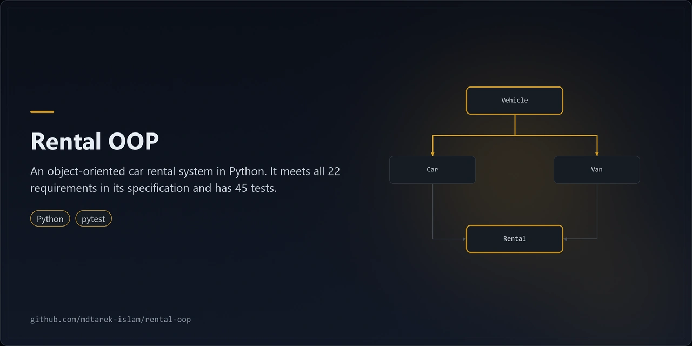
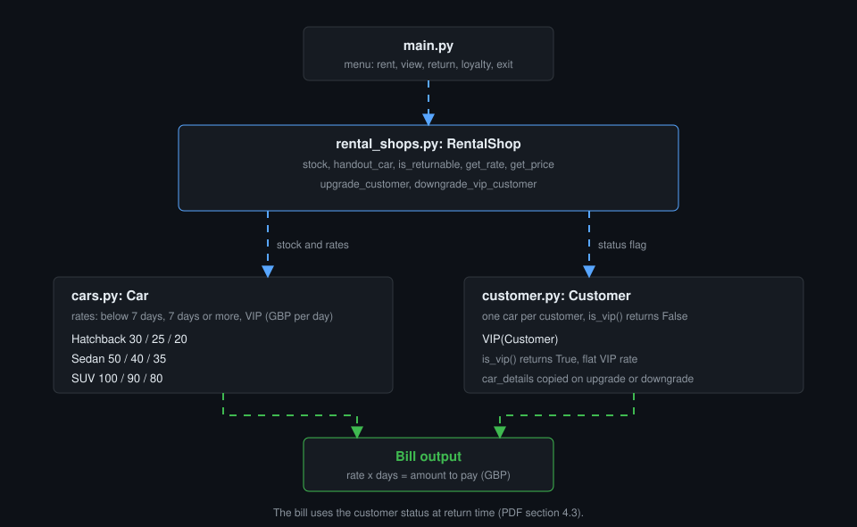
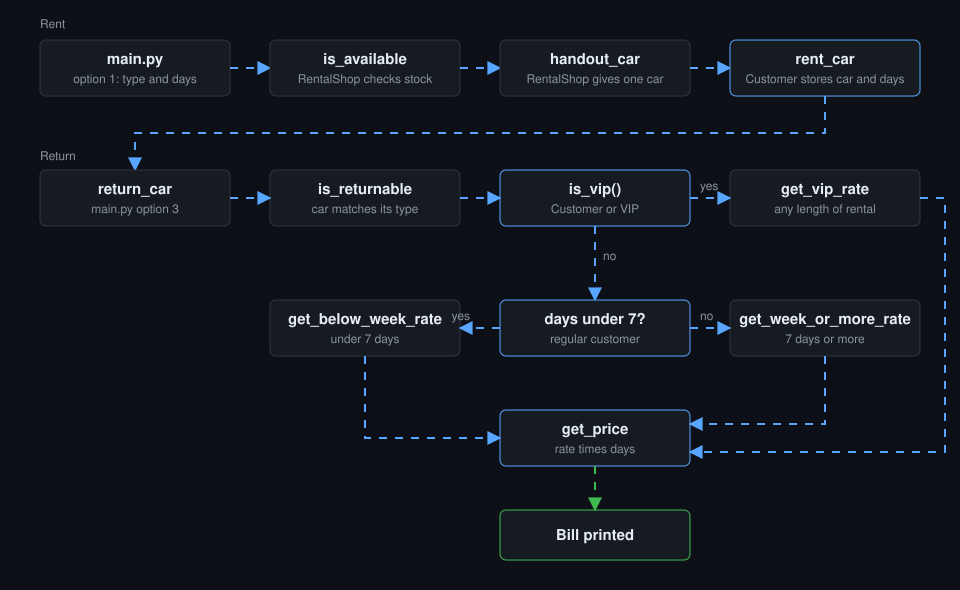

<p align="center"></p>

# rental-oop

A command-line car rental platform in Python, built on classes and inheritance.

## Overview

rental-oop is a command-line car rental platform written in Python. It models a shop, three car types and two customer types with classes and inheritance. It uses the standard library only.

| Layer | Technology |
|---|---|
| Language | Python 3.9 or later |
| Runtime packages | None, standard library only |
| Tests | pytest 8 or later |
| Interface | Interactive command-line menu |

## Architecture



1. `main.py` runs the menu loop and reads each answer.
2. `RentalShop` in `rental_shops.py` holds the stock, picks the rate, and returns the price.
3. `Car` and its subclasses in `cars.py` carry the daily rates.
4. `Customer` and `VIP` in `customer.py` hold the rental and answer `is_vip()`.
5. The return option prints the bill: rate times days.



The second diagram traces one rental and its return, and shows how the rate depends on customer type and rental length.

## Features

- Shop `RentACar` starts with 4 hatchbacks, 3 sedans and 3 SUVs.
- Rent one car per customer for a whole number of days.
- Rates in GBP per day:

| Car | Under 7 days | 7 days or more | VIP |
|---|---|---|---|
| Hatchback | 30 | 25 | 20 |
| Sedan | 50 | 40 | 35 |
| SUV | 100 | 90 | 80 |

- VIP customers pay the VIP rate for any length of rental.
- View stock per car type and in total.
- Return a car and print the bill.
- Join or leave the loyalty programme. The rented car moves to the new account.
- Class hierarchy: `Hatchback`, `Sedan` and `SUV` extend `Car`. `VIP` extends `Customer` and overrides `is_vip()`.

### Engineering notes

- All 22 PDF requirements are met. See [REQUIREMENTS.md](./REQUIREMENTS.md) for the traceability table.
- 45 tests pass with pytest.
- Five bugs were fixed:
  1. `add_to_stock` stored one shared car instance. It now creates a new car each time.
  2. Zero or negative rental days gave a zero or negative bill. Input now needs 1 or more.
  3. Upgrade and downgrade shared one details dictionary between accounts. Each account now holds a copy.
  4. `is_returnable` did not check the car type. It now checks the car matches the type.
  5. The menu started on import. It now starts only from `main()`.
- Known issue, kept by design: the bill uses the customer status at return time (PDF section 4.3). A customer who joins the programme before returning pays the VIP rate.

## Quick start

```bash
git clone https://github.com/mdtarek-islam/rental-oop.git
cd rental-oop
python main.py
```

No install step is needed. To run the tests:

```bash
pip install -r requirements-dev.txt
python -m pytest -q
```

## Configuration

No configuration needed. The loading pause is 0.5 seconds per step. Pass `--no-delay` to remove it.

## Usage

```bash
python main.py            # interactive menu
python main.py --no-delay # skip the loading pauses
```

Enter a name to log in, then pick an option:

1. Rent a car: type `hatchback`, `sedan` or `suv`, then the number of days.
2. Check available cars.
3. Return car and see the bill.
4. Loyalty programme: press `y` to join or leave.
5. Exit.

## Licence and contribution

Released under the MIT licence. See [LICENSE](./LICENSE). Raise bugs and requests as GitHub issues on the repository.

## Maintenance status

Maintained: the 45 tests pass on main and `python main.py` runs from a clean clone.
